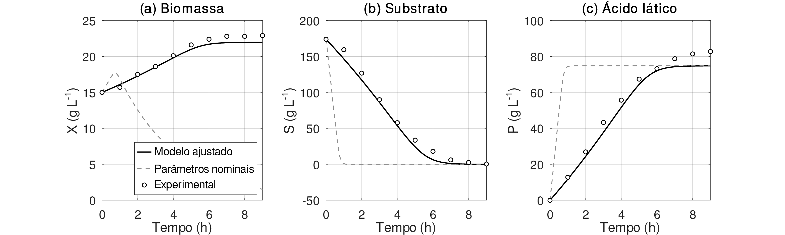
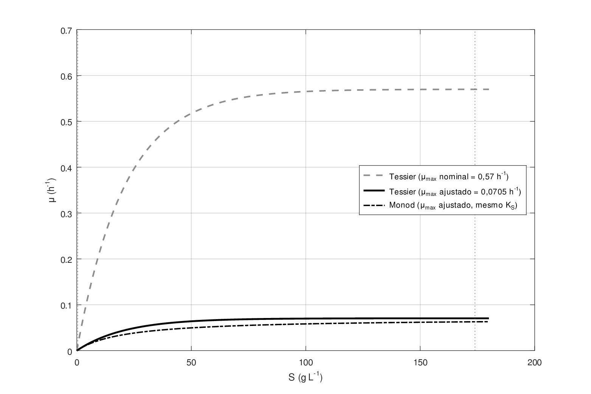
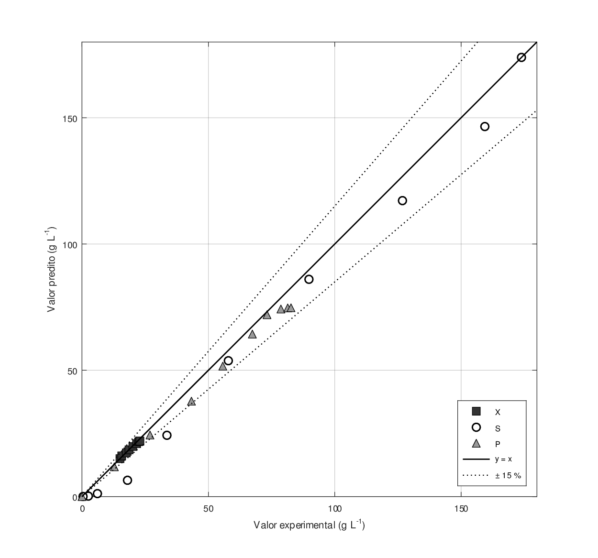

# Modelagem cinética da produção de ácido lático por *Lactiplantibacillus plantarum*

Modelagem e simulação de um cultivo em biorreator batelada de *Lactiplantibacillus
plantarum* para produção de ácido lático, usando o **modelo cinético de Tessier**
para a taxa específica de crescimento. Implementação em **GNU Octave**.

Trabalho da disciplina *Modelagem e Simulação Computacional de Processos
Biotecnológicos* — Faculdade de Biotecnologia, UFPA (Prof. Bruno Viegas).

## Modelo

Taxa específica de crescimento (Tessier):

$$\mu = \mu_{max}\left(1 - e^{-S/K_S}\right)$$

Sistema de EDOs a partir dos balanços de massa (batelada):

$$\frac{dX}{dt} = (\mu - k_d)\,X \qquad
\frac{dS}{dt} = -\frac{\mu}{Y_{X/S}}\,X \qquad
\frac{dP}{dt} = \frac{\mu\,Y_{P/S}}{Y_{X/S}}\,X$$

onde `X` = biomassa, `S` = substrato (glicose) e `P` = ácido lático (g/L).

## Resultados

Os parâmetros nominais do enunciado esgotam o substrato em menos de 1 h (R² = −0,33).
Reestimando apenas os parâmetros **cinéticos** por mínimos quadrados (simplex de
Nelder–Mead), o ajuste sobe para **R² = 0,985**.

| Parâmetro | Nominal | Ajustado |
|---|---|---|
| μ_max (h⁻¹) | 0,57 | **0,0705** |
| k_d (h⁻¹) | 0,30 | **≈ 0** |
| K_S (g/L) | 21 | 21 (mantido) |
| Y_X/S (g/g) | 0,04 | 0,04 (mantido) |
| Y_P/S (g/g) | 0,43 | 0,43 (mantido) |

**Dinâmica de X, S e P** — modelo ajustado (linha) vs. nominal (tracejado) vs. experimental (pontos):



**Taxa específica μ(S)** — nominal superestima o crescimento em toda a faixa medida:



**Paridade predito × experimental** (faixa de ±15 %):



## Estrutura

```
src/
├── fun_tessier.m            função com o sistema de EDOs (modelo de Tessier)
├── main.m                   simulação com os parâmetros nominais do enunciado
├── estimacao_parametros.m   reestimação dos parâmetros + análise de sensibilidade a K_S
└── gerar_figuras.m          gera as figuras da pasta figuras/
figuras/                     gráficos de resultado (.png e .pdf)
```

## Como executar

Requer [GNU Octave](https://octave.org/) (testado na versão 11.3.0).

```bash
cd src
octave main.m                    # simulação com parâmetros nominais
octave estimacao_parametros.m    # ajuste de parâmetros e métricas
octave gerar_figuras.m           # regenera as figuras
```
